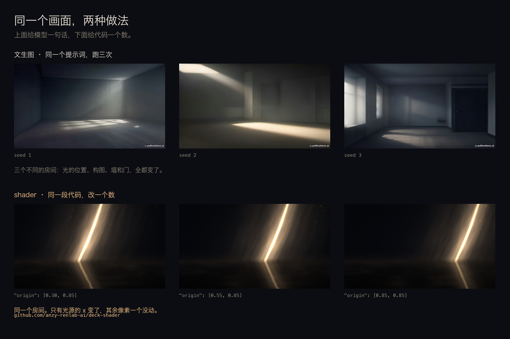
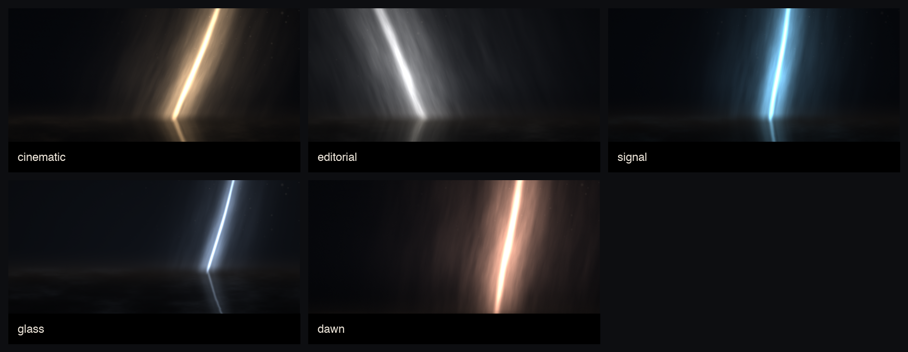

<div align="center">


# deck-shader

**Decks whose light is computed, not painted.**

Write a JSON file. A shader renders the light — volumetric beams, caustics, drifting dust — and you get a `.pptx` where the text is still editable.

`python3 scripts/render.py examples/hello/deck.json`

[](https://pypi.org/project/deck-shader/)
[](https://github.com/anzy-renlab-ai/deck-shader/actions/workflows/test.yml)
[](LICENSE)

<a href="https://anzy-renlab-ai.github.io/deck-shader/"><b>▶ Try it live in the browser — no install</b></a>

<sub>A 6-second render from `examples/hello`. The text is native PowerPoint text; only the light is baked.</sub>

</div>

---

## The problem

Every slide background you have ever made is one of three things: a flat gradient, a stock photo, or a blurred blob someone spent twenty minutes on.

None of them have light. They have *the suggestion of* light — a Photoshop drop shadow, a radial gradient, an overlay at 12% opacity.

Light is a physical process. It scatters through dust, bends at a surface, casts caustics on a floor. That is a few lines of math, and your GPU has been able to do it in real time since 2010.

So: describe the slide in JSON, render the light with a fragment shader, and lay native PowerPoint text on top.

```
deck.json  ──►  WebGL shader  ──►  background.png  ──►  .pptx (editable text)
```

## Why not just generate the background with a model

Because you can't point at it.

Ask a text-to-image model for "a warm beam of light cutting through a dark room" and you get something plausible. Ask it again and you get a different room. Change the color and the composition moves with it. There is no *"no, that beam, move it 40px left"* — there is only re-rolling and hoping.

A shader is the same picture, but every property is a named number you can edit.

| | text-to-image | this |
|---|---|---|
| change the light's position | re-roll, keep your fingers crossed | `"origin": [0.55, 0.85]` → `[0.42, 0.85]` |
| run it twice | two different pictures | byte-identical |
| brand color | drifts between generations | one hex, in one place |
| the deck's 10 slides look related | if you're lucky | because they share a preset |
| review a change | look at pixels | `git diff` |
| who can fix it in six months | someone with the same model | anyone who can read JSON |
| an agent can check its own work | no | re-render, assert the number |



Top row: one prompt, three runs, three different rooms. Bottom row: one shader, one number changed, everything else identical. Nothing in the bottom row was re-rolled.

The honest tradeoff: a shader cannot give you a photograph. It gives you light, atmosphere, and texture — procedural things. For a person, a product, a street, use a photo. This is the layer that decides whether the photo sits in a scene or on a slide.

## Built for the one thing models are actually good at

Ask a model to "design a beautiful slide" and you get an opinion. Ask it to make a number 8% bigger, or move a rule 40px left, or swap the light from `#ffc98a` to `#7fd1ff` — and it is flawless.

Layout is a coordinate problem. Typography is a set of numbers. Light is math. All of it is expressible, all of it is checkable, none of it is a matter of taste once you've decided what the page says.

So the deck is a file with pixel coordinates and a shader, and the model works the way it works best: edit → render → look → edit. Every change compiles into something you can see and `git diff`.

```
you:   把第 3 页的光往左挪一点，标题再小一号
agent: [edits origin, sizePt] [renders] [opens the png]
       origin x 0.55 → 0.42; title 40 → 36. beam now clears the text.
```

This is the part most "AI makes your slides" tools skip. They put the model in the role of *designer* — judgment, taste, one shot, no way to check. It is far better as a *craftsman*: exact, iterative, verifiable.

The deck is a file. The renderer is a script. Nothing in the loop is un-inspectable.

It ships with a `SKILL.md`, so Claude Code, WorkBuddy, or any host that reads skills can pick it up as-is.

## What you get

| | |
|---|---|
| `.pptx` | 13.33 × 7.5 in, background is a rendered image, **all text is native and editable** |
| `.jpg` | 1920 × 1080 background plates, ~150 KB each (`--png` for lossless, ~1.7 MB) |
| `notes` | per-slide speaker notes, written straight into the pptx |

A four-slide deck comes out at **0.3 MB**. The whole deck is a few hundred kilobytes
because the light is a few dozen numbers, not a photograph.

## Quickstart

```bash
pip install deck-shader
deck-shader deck.json --out out/deck.pptx
```

Or from a checkout:

```bash
git clone https://github.com/anzy-renlab-ai/deck-shader && cd deck-shader
pip install python-pptx
python3 scripts/render.py examples/hello/deck.json --out out/hello.pptx
```

Requires Chrome (headless, for the WebGL pass). macOS path is auto-detected; override with `CHROME=/path/to/chrome`. No GPU needed — it falls back to SwiftShader.

It also refuses to fail quietly. A missing file, broken JSON, an unknown preset,
`--pages 9` on a four-page deck, a missing image, or a Chrome that handed back a
flat black frame each exits with a message that names the problem instead of
writing a deck that looks fine until you open it. `tests/` renders a real deck on
every push (see the badge above).

## A slide is a list of elements at exact coordinates


Content slides are not "title + bullets + a theme". Every element is placed by
hand — a text box at `x: 704`, a 1px rule at `x: 656`, a 96px number that is
allowed to be bigger than the title because on this page it is the subject.

```json
{ "type": "rect", "x": 656, "y": 208, "w": 1, "h": 116, "fill": "#D8DEE4" },
{ "type": "text", "x": 704, "y": 238, "w": 504, "h": 120, "paragraphs": [
    { "align": "left", "lineSpacingPct": 170, "runs": [
      { "text": "每一页只描述它自己要说的那件事。", "sizePt": 17,
        "color": "#142B40", "font": "PingFang SC" } ] } ] }
```

Three element types: `text` (paragraphs → runs, each with its own font, size,
color, letter-spacing), `rect` (hairlines, fills, dividers), `image`.

Canvas is **1280 × 720**. 1 px = 0.75 pt, 1 in = 96 px — the numbers are the
same ones you'd read off a Figma inspect panel, so you can measure once and
type it in.


The full example is `examples/precision/`.

### Why coordinates and not a layout engine

A layout engine chooses where things go. That is exactly the thing you cannot
delegate when the deck has to say something: the sentence that matters gets the
same weight as the sentence that doesn't, and all ten slides come out looking
like the same slide.

Templates are *selected*. Coordinates are *written*. The difference shows up as
whether a page can be louder than the page before it.

## A deck is a JSON file

```json
{
  "preset": { "light": "#ffc98a", "origin": [0.55, 0.85], "dir": [-0.42, -1.0], "intensity": 1.0 },
  "style":  { "font": "Songti SC", "titleColor": "FFFFFF" },
  "slides": [
    {
      "kicker": "DECK · SHADER",
      "title": "光线是可以计算的",
      "titleTop": 330,
      "sub": "把 PPT 的背景交给 WebGL",
      "subTop": 470,
      "notes": "开场：先让他们注意到光，再注意到字。"
    }
  ]
}
```

| field | meaning |
|---|---|
| `preset.light` | light color |
| `preset.origin` | where the beam enters, in normalized stage coords |
| `preset.dir` | beam direction |
| `preset.intensity` | how hard it hits |
| `preset.width` | beam thickness — 0.5 is a laser, 2.0 is a window |
| `preset.haze` | dust in the air; 0 is a black studio, 1 is a foggy room |
| `preset.floor` | how much the light bounces off the floor |
| `preset.horizon` | where the floor starts, −0.5 low and wide, 0.2 tight |
| `preset.grain` | film grain; drop it to 0 and the background compresses smaller |
| `time` | shader time; change it and the dust moves, the beam breathes |

## Presets

Five shipped, and they are physics — not five color swatches. `width` changes the
falloff of all three gaussian layers, `haze` lifts the air near the source, `floor`
changes how much of the beam is reflected back up.



| preset | light | what it is |
|---|---|---|
| `cinematic` | `#ffc98a` | warm key, narrow beam, black room |
| `editorial` | `#e8e2d6` | a wide window of cold daylight, high floor bounce |
| `signal` | `#7fd1ff` | blue monitor glow, tight beam |
| `glass` | `#bcd9ff` | thin bright filament inside a hazy room |
| `dawn` | `#ffb08a` | low horizon, warm, the floor taking most of the light |

`deck-shader deck.json --preset dawn` overrides whatever the JSON says, which is
how you restyle a whole deck with one flag.

## Why this exists

Two observations.

**One.** A deck is read in three seconds, and the first thing anyone perceives is not your words — it is the light in the room. Slides with real light read as *staged*; slides with gradients read as *slides*.

**Two.** Agent skills that "generate decks" all stop at layout. They arrange boxes. None of them render anything. The moment you want a背景 that looks photographed, you are back in Photoshop.

This is the missing layer: a renderer, not a template.

## Roadmap

- [x] volumetric beam + floor caustics + dust, parameterized
- [x] JSON → PNG → editable `.pptx`
- [x] absolute element model: `text` / `rect` / `image` at 1280×720, 1px = 0.75pt
- [x] presets: `cinematic`, `editorial`, `signal`, `glass`, `dawn`
- [x] HTML runtime (same shader, live in a browser)
- [ ] video export (15s loop, for social covers)
- [ ] paper mode: arXiv PDF → deck outline → rendered deck

## Works with any agent

Not tied to one host. `AGENTS.md` is the entry point for anything that reads it
(Codex, Cursor, Amp, Jules, …); `SKILL.md` is the entry point for skill-based
hosts (Claude Code, WorkBuddy, …).

| host | how |
|---|---|
| any agent | `pip install deck-shader`, then point it at `AGENTS.md` |
| Claude Code | `git clone` into `~/.claude/skills/deck-shader` |
| WorkBuddy / CodeBuddy | `git clone` into `~/.workbuddy/skills/deck-shader` |
| Codex / Cursor / Amp | copy `AGENTS.md` into the project, or `pip install deck-shader` and let it read the repo |
| no agent at all | `deck-shader deck.json` and edit the pptx by hand |

The reason this ports cleanly: there is no proprietary API and no state. The
contract is a JSON file in, a file on disk out.

## License

MIT.
